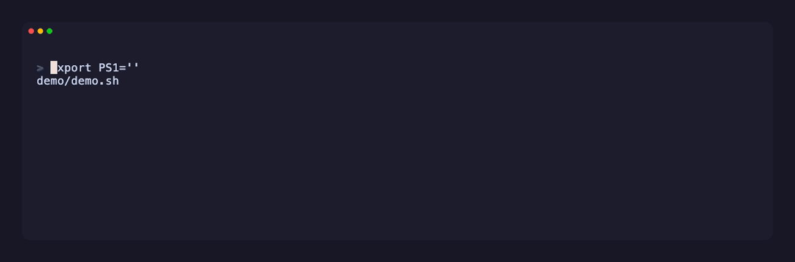
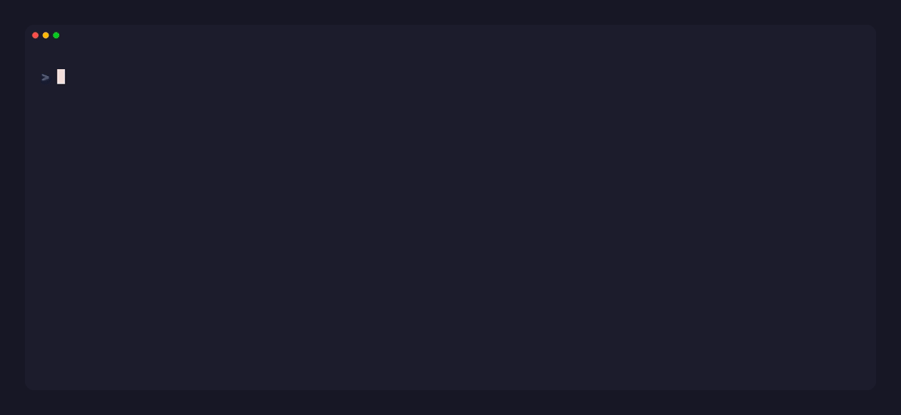

# Claude Code status line

A compact status line for [Claude Code](https://claude.com/claude-code) that shows what matters at a glance:

```
Opus 5.5 | ███░░░░░ 42% | ⧗ 12 min | 73%↑ 1:47 | my-project | 🌱 fix-login | 📁 scratch | ⓘ /sl-legend
```

| Segment | Meaning |
| --- | --- |
| `Opus 5.5` | The model that is answering |
| `███░░░░░ 42%` | How full the context window is (green, yellow, red) |
| `⧗ 12 min` | Time until the prompt cache expires. After that, the next message costs more |
| `73%↑ 1:47` | Subscription usage of the window closest to its limit, and time until it resets. `↑` means you are using it faster than time passes |
| `my-project` | Current folder (Cmd+click opens it) |
| `🌱 fix-login` | Git worktree name, only inside a worktree |
| `📁 scratch` | Claude's scratchpad for this session, only when it has files |
| `ⓘ /sl-legend` | Reminder that typing `/sl-legend` in Claude Code prints this table in the terminal |



_The animation runs the real `statusline.sh` on made-up session data._

## Install: let Claude Code do it

You do not need to edit anything by hand. Open Claude Code in any folder and paste this prompt:

```text
Set up the Claude Code status line from https://github.com/FilipMessa/claude-code-statusline for me.

1. Make sure `jq` is installed. If it is not, tell me how to install it for my system, or install it if I agree.
2. Download `statusline.sh` from that repository into `~/.claude/`, and `commands/sl-legend.md` into `~/.claude/commands/` (create the folder if missing).
3. Run `chmod +x ~/.claude/statusline.sh`.
4. Open `~/.claude/settings.json` (create it if missing, keep all my existing settings) and add:
   "statusLine": { "type": "command", "command": "~/.claude/statusline.sh", "refreshInterval": 30 }
   If I already have a `statusLine`, show me the old value and ask before replacing it.
5. Test the script by piping sample JSON into it, and show me the output.
6. Tell me to restart Claude Code, then type `/sl-legend` to see what each part of the status line means.
```

Claude Code will ask permission for each step.



_An illustration of the flow, not a live recording._

## Install: manually

```bash
git clone https://github.com/FilipMessa/claude-code-statusline.git
cd claude-code-statusline
mkdir -p ~/.claude/commands
cp statusline.sh ~/.claude/
cp commands/sl-legend.md ~/.claude/commands/
chmod +x ~/.claude/statusline.sh
```

Then add this to `~/.claude/settings.json`:

```json
{
  "statusLine": {
    "type": "command",
    "command": "~/.claude/statusline.sh",
    "refreshInterval": 30
  }
}
```

Restart Claude Code, then type `/sl-legend` to check it.

## Requirements

- Claude Code
- `bash` and [`jq`](https://jqlang.github.io/jq/) (`brew install jq` on macOS, `sudo apt install jq` on Debian/Ubuntu)
- A terminal that supports clickable links (iTerm2, WezTerm, Kitty, Windows Terminal, recent VS Code). Others still show the line, just without links.

## Customize

Ask Claude Code, for example:

- "Remove the cache countdown from my status line."
- "Show the git branch in my status line."
- "Make the context bar 12 cells wide."

Folders inside `~/projects` are shown relative to it. If your projects live elsewhere, set `STATUSLINE_PROJECTS_DIR`, for example in your shell profile:

```bash
export STATUSLINE_PROJECTS_DIR="$HOME/code"
```

If you change a segment, update `commands/sl-legend.md` too so the legend stays accurate.

## Re-recording the animations

The GIFs in `demo/` are made with [VHS](https://github.com/charmbracelet/vhs) (`brew install vhs`). From the repository root:

```bash
vhs demo/demo.tape
vhs demo/setup.tape
```

## How it works

Claude Code runs the script every time the session changes, and at least every 30 seconds (`refreshInterval`). It sends a JSON description of the session on stdin: model, context usage, rate limits, prompt cache and working directory. The script prints one line, with ANSI colors and clickable links, and Claude Code shows it under the prompt. See the [status line docs](https://code.claude.com/docs/en/statusline) for the full input format.

## License

MIT
